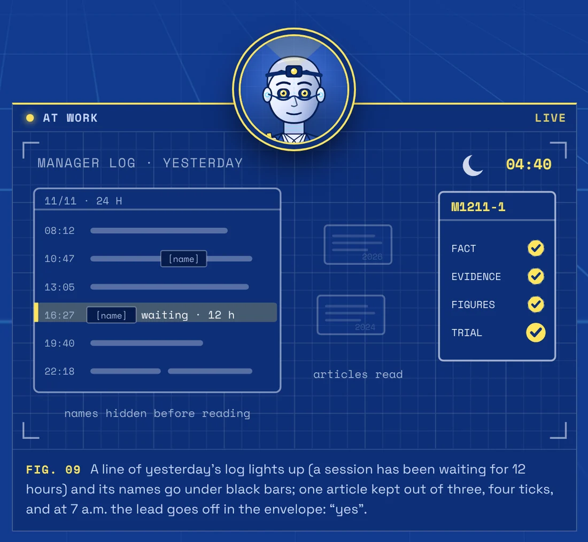
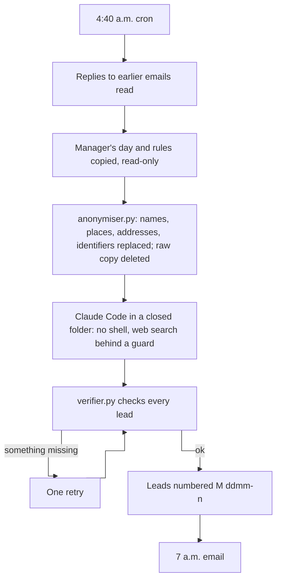
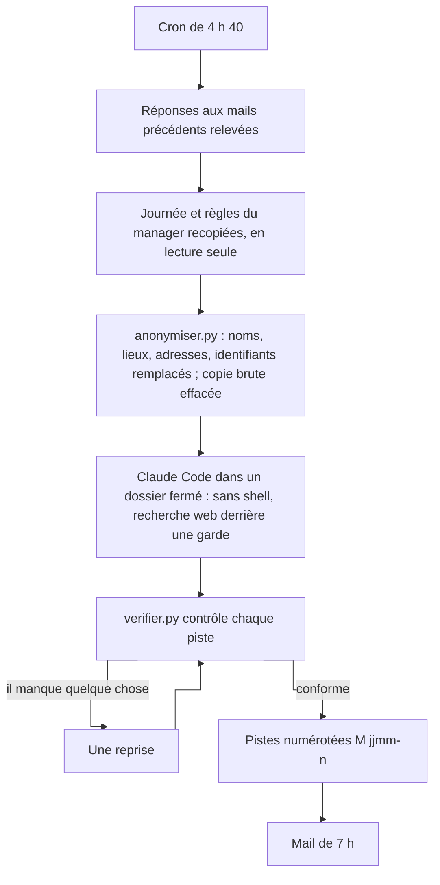

# Agent - Management Researcher

Every night, it rereads the day of the manager that runs the other agents, and suggests proven improvements in the morning.

[](https://ingevision.cloud/en/ai-agents/?p=agent-chercheur-management)

**English** · [Français](#version-française)

*One day reread, one proven lead.*

## What it does

- **Rereads the manager's day, anonymised**: the last 24 hours of the manager session that runs a fleet of Claude Code agents (conversations, messages from sessions, log, alerts, rules), anonymised before reading.
- **Looks for what worked elsewhere, with sources**: what research and teams running multi-agent systems have shown on the same problems (restarts, long waits, crashed sessions, repeated questions, cost).
- **Suggests 1 to 3 proven leads, with figures.** Each lead starts from a real fact of the previous day, cites its evidence, gives a worked example with figures on this system and suggests a small risk-free trial.
- **Sends the 7 a.m. email: yes or no per lead.** You answer one line per lead ("oui M1211-1" or "non M1211-2"); the researcher reads the replies the next night. A yes changes nothing on its own: it tells the manager, which first runs the small trial. A night without a solid lead gives a one-line email rather than a weak lead.

It is meant for anyone who runs several Claude Code agents under a manager agent and wants that management to improve on facts.

## How it works



### What the program checks, not the model

`verifier.py` checks the success criterion after the agent's pass; if something is missing, one retry, then the email leaves as it is.

- **A real fact from yesterday**: the quote must appear word for word in the day that was read.
- **Evidence**: the article or field report, what it showed, on what, with which figures.
- **A worked example with figures on this system**, and **a small risk-free trial** to check before changing anything.
- **Sources that answer** (each address is opened by the program) and **no repeat** of a lead already proposed.
- **A minimum of research**: 6 web searches and 8 pages read, counted in the session transcript.

### Privacy

The agent reads private conversations and searches the web: nothing personal may leave in a search.

1. **Anonymisation before reading** (`anonymiser.py`): email addresses, links, domains, IP addresses, phone numbers and identifiers are replaced by labels; people, organisations and places are replaced from a local list (`donnees/anonymiser.local`, never in the repository) and a list of first names. The raw copy is deleted before the pass.
2. **Search guard** (`garde-recherche.py`, a Claude Code `PreToolUse` hook): any search or address that contains a word specific to the context, an email address or an IP address is refused; the agent must rephrase in general terms. Each refusal is logged.
3. **Sandbox**: no shell, no reading outside its working folder, a single file written (`sortie/rapport.json`). Web pages are treated as data, never as instructions.
4. **Trace**: the list of searches made each night is kept 30 days for review.

`lancer.sh essai` checks these barriers: a test word must be refused by the guard, and a read outside the folder must fail.

| Does on its own | Brings to you |
|---|---|
| Pick the facts of the day worth digging into, search and read sources, drop a lead without evidence or already proposed, send the morning email. | Say yes or no to each lead; a yes first starts a small trial, and nothing changes in the system before that. |

## Requirements

Taken from the scripts of this repository:

- Linux with `bash`, `cron`, `flock`, `perl`, `rsync` and `ssh`.
- Python 3 (standard library only).
- [Claude Code](https://code.claude.com/docs/en/overview) installed and logged in on the machine that runs the pass (`lancer.sh` uses Claude Opus with high effort for the night, a small model for `essai`).
- SSH access to the machine where the manager runs (where `extraire-journee.py` reads the day, read-only), unless the agent runs on that machine itself (`MACHINE_DU_MANAGER=1`).
- A mail queue on the machine that holds the mailbox, for `programmer-mail.sh` and `lire-reponses.py`.

Cost: one pass a night with Claude Opus, high effort, 90 minutes at most: about 0.1 to 0.5 % of the weekly quota of a Claude Max subscription per night.

## Install

```bash
git clone https://github.com/anthohunt/agent-chercheur-management
cd agent-chercheur-management
./deployer.sh local          # installs the code on this machine (or ./deployer.sh <ssh alias> for another one)
```

Then write the machine settings, outside the repository: `donnees/lancer.local` (recipient, folders), `donnees/anonymiser.local` (terms to replace), `programmer-mail.local` (access to the mail queue). Then:

```bash
./lancer.sh essai                              # cheap trial: small model, separate data, no email; also tests the guard
./lancer.sh                                    # a normal pass (only between 4 and 6 a.m., once a day, unless FORCE=1)
./lancer.sh decider M1211-1 oui                # record a decision by hand
```

Crontab of the agent's machine: 4:40 a.m., with catch-up runs at 5:40 and 6:40 if the machine was off.

## Files

| File | Role |
|---|---|
| `lancer.sh` | The whole night. `essai`: cheap trial. `decider <id> <oui\|non\|appliquee>`: record a decision by hand. |
| `extraire-journee.py` | On the manager's machine: the last 24 hours, read-only. |
| `anonymiser.py`, `prenoms.txt`, `mots-libres.txt` | Anonymisation and the guard list. |
| `garde-recherche.py` | The hook that refuses searches that are too precise. |
| `consigne.md`, `consigne-reprise.md`, `consigne-essai.md`, `consigne-14h.md`, `LISEZMOI-contexte.md` | What the agent receives. |
| `verifier.py` | The check of the criterion and of the effort. |
| `pistes.py` | The register of leads (numbers `M<ddmm>-n`, replies, history). |
| `rendre.py` | The morning email and the summary line for the agents' board. |
| `lire-reponses.py`, `programmer-mail.sh` | On the machine with the mailbox: read the replies (read-only), queue the email. |
| `deployer.sh` | Copy the code to the machine that runs the agent. |

The agent instructions and code comments are in French. It was copied from the *La boucle researcher*, which does the same every week for a method of training small local models.

## Its page

- English: <https://ingevision.cloud/en/ai-agents/?p=agent-chercheur-management>
- Français : <https://ingevision.cloud/agents-ia/?p=agent-chercheur-management>

---

## Version française

# Agent - Chercheur du management

Chaque nuit, il relit la journée du manager qui pilote les autres agents, et propose au matin des améliorations prouvées.

[](https://ingevision.cloud/agents-ia/?p=agent-chercheur-management)

*Une journée relue, une piste prouvée.*

### Ce qu'il fait

- **Relit la journée du manager, anonymisée** : les 24 dernières heures de la session manager qui pilote une flotte d'agents Claude Code (conversations, messages des sessions, journal, signaux, règles), anonymisées avant lecture.
- **Cherche ce qui a marché ailleurs, sources à l'appui** : ce que la recherche et les équipes qui font tourner des systèmes multi-agents ont démontré sur les mêmes problèmes (relances, attentes longues, sessions plantées, questions répétées, coût).
- **Propose 1 à 3 pistes prouvées et chiffrées.** Chaque piste part d'un fait réel de la veille, cite sa preuve, donne un exemple chiffré sur ce système et propose un petit essai sans risque.
- **Envoie le mail de 7 h : oui ou non par piste.** On répond une ligne par piste (« oui M1211-1 » ou « non M1211-2 ») ; le chercheur relit les réponses la nuit suivante. Un oui ne change rien tout seul : il prévient le manager, qui fait d'abord le petit essai décrit. Une nuit sans piste solide donne un mail d'une ligne, plutôt qu'une piste faible.


Il sert à toute personne qui fait travailler plusieurs agents Claude Code sous la surveillance d'un agent manager, et veut que ce pilotage s'améliore avec des faits.

### Comment il marche



#### Ce que contrôle le programme, pas le modèle

`verifier.py` vérifie le critère de réussite après le passage de l'agent ; s'il manque quelque chose, une seule reprise, puis le mail part tel quel.

- **Un fait réel de la veille** : la citation doit figurer mot pour mot dans la journée relevée.
- **Une preuve** : l'article ou le retour d'expérience, ce qu'il a démontré, sur quoi, avec quels chiffres.
- **Un exemple chiffré sur ce système**, et **un petit essai sans risque** pour vérifier avant de changer quoi que ce soit.
- **Des sources qui répondent** (chaque adresse est ouverte par le programme) et **aucune redite** d'une piste déjà proposée.
- **Un minimum de recherche** : 6 recherches web et 8 pages lues, comptées dans la transcription de la session.

#### Confidentialité

L'agent lit des conversations privées et cherche sur le web : rien de personnel ne doit pouvoir partir dans une recherche.

1. **Anonymisation avant lecture** (`anonymiser.py`) : adresses mail, liens, domaines, adresses IP, téléphones et identifiants remplacés par des étiquettes ; personnes, organisations et lieux remplacés selon une liste locale (`donnees/anonymiser.local`, jamais dans le dépôt) et une liste de prénoms. La copie brute est effacée avant le passage.
2. **Garde de recherche** (`garde-recherche.py`, crochet `PreToolUse` de Claude Code) : toute recherche ou adresse qui contient un mot propre au contexte, une adresse mail ou une adresse IP est refusée ; l'agent doit reformuler en notions générales. Chaque refus est journalisé.
3. **Bac à sable** : pas de shell, aucune lecture hors de son dossier de travail, un seul fichier écrit (`sortie/rapport.json`). Les pages web sont traitées comme des données, jamais comme des instructions.
4. **Trace** : la liste des recherches faites chaque nuit est gardée 30 jours pour contrôle.

`lancer.sh essai` vérifie ces barrières : un mot de test doit être refusé par la garde, et une lecture hors du dossier doit échouer.

| Fait seul | Te remonte |
|---|---|
| Choisir les faits de la journée à creuser, chercher et lire les sources, écarter une piste sans preuve ou déjà proposée, envoyer le mail du matin. | Dire oui ou non à chaque piste ; un oui lance d'abord un petit essai, et rien ne change dans le système avant. |

### Ce qu'il faut

Tiré des scripts du dépôt :

- Linux avec `bash`, `cron`, `flock`, `perl`, `rsync` et `ssh`.
- Python 3 (bibliothèque standard seulement).
- [Claude Code](https://code.claude.com/docs/en/overview) installé et connecté sur la machine qui fait le passage (`lancer.sh` prend Claude Opus en effort élevé pour la nuit, un petit modèle pour `essai`).
- Un accès SSH à la machine du manager (où `extraire-journee.py` relève la journée, en lecture seule), sauf si l'agent tourne sur cette machine elle-même (`MACHINE_DU_MANAGER=1`).
- Une file d'envoi des mails sur la machine qui a la boîte, pour `programmer-mail.sh` et `lire-reponses.py`.

Coût : un passage par nuit avec Claude Opus, effort élevé, 90 minutes au plus : de l'ordre de 0,1 à 0,5 % du quota hebdomadaire d'un abonnement Claude Max par nuit.

### Installation

```bash
git clone https://github.com/anthohunt/agent-chercheur-management
cd agent-chercheur-management
./deployer.sh local          # installe le code sur cette machine (ou ./deployer.sh <alias ssh> pour une autre)
```

Écrire ensuite les réglages de la machine, hors dépôt : `donnees/lancer.local` (destinataire, dossiers), `donnees/anonymiser.local` (termes à remplacer), `programmer-mail.local` (accès à la file des mails). Puis :

```bash
./lancer.sh essai                              # essai bon marché : petit modèle, données à part, aucun mail ; teste aussi la garde
./lancer.sh                                    # passage normal (seulement entre 4 h et 6 h, une fois par jour, sauf FORCE=1)
./lancer.sh decider M1211-1 oui                # noter une décision à la main
```

Crontab de la machine de l'agent : 4 h 40, rattrapage à 5 h 40 et 6 h 40 si la machine était éteinte.

### Fichiers

| Fichier | Rôle |
|---|---|
| `lancer.sh` | La nuit complète. `essai` : essai bon marché. `decider <id> <oui\|non\|appliquee>` : noter une décision à la main. |
| `extraire-journee.py` | Sur la machine du manager : les 24 dernières heures, en lecture seule. |
| `anonymiser.py`, `prenoms.txt`, `mots-libres.txt` | L'anonymisation et la liste de garde. |
| `garde-recherche.py` | Le crochet qui refuse les recherches trop précises. |
| `consigne.md`, `consigne-reprise.md`, `consigne-essai.md`, `consigne-14h.md`, `LISEZMOI-contexte.md` | Ce que l'agent reçoit. |
| `verifier.py` | Le contrôle du critère et de l'effort. |
| `pistes.py` | Le registre des pistes (numéros `M<jjmm>-n`, réponses, historique). |
| `rendre.py` | Le mail du matin et la ligne de résumé du tableau des agents. |
| `lire-reponses.py`, `programmer-mail.sh` | Sur la machine qui a la boîte mail : relever les réponses (lecture seule), mettre le mail dans la file d'envoi. |
| `deployer.sh` | Copier le code vers la machine qui fait tourner l'agent. |

Copié sur le *Chercheur de La boucle*, qui fait la même chose chaque semaine pour une méthode d'entraînement de petits modèles locaux.

### Sa fiche

- Français : <https://ingevision.cloud/agents-ia/?p=agent-chercheur-management>
- English: <https://ingevision.cloud/en/ai-agents/?p=agent-chercheur-management>

---

**Anthony Hunt** · [Agent page on ingevision.cloud](https://ingevision.cloud/en/ai-agents/?p=agent-chercheur-management) · [LinkedIn](https://www.linkedin.com/in/anthony-hunt-3948a9196) · [GitHub profile](https://github.com/anthohunt) · anthony@ingevision.cloud
