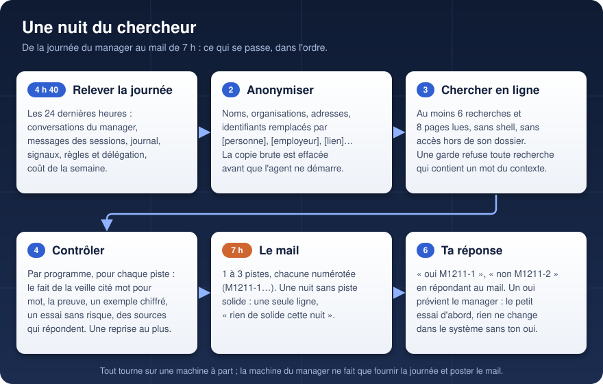
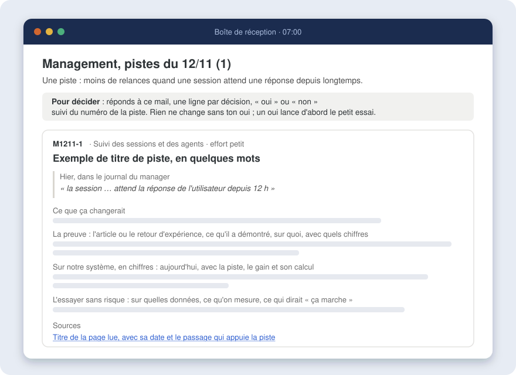

# Agent - Chercheur du management

**Chaque nuit, il relit la journée du manager qui pilote une flotte d'agents Claude Code, cherche en ligne ce qui a
marché ailleurs pour des problèmes semblables, et propose au matin des pistes d'amélioration : chacune part d'un fait
réel de la veille, apporte sa preuve, un exemple chiffré et un petit essai sans risque.**

## Pourquoi
Quand une dizaine de sessions Claude Code travaillent en parallèle sur plusieurs machines, une session « manager » les
surveille, les relance, les débloque et ne remonte à son utilisateur que ce qui lui revient. Ce manager suit des règles
écrites au fil des semaines. Le chercheur sert à les améliorer avec des faits : il regarde ce qui a coincé hier
(relances, attentes longues, sessions plantées, questions répétées, coût), puis ce que la recherche et les équipes qui
font tourner des systèmes multi-agents ont démontré sur ces problèmes.

## Le mail du matin

On répond au mail, une ligne par piste : « oui M1211-1 » ou « non M1211-2 ». Le chercheur relit les réponses la nuit
suivante. Un oui ne change rien tout seul : il prévient le manager, qui fait d'abord le petit essai décrit. Une nuit sans
piste solide donne un mail d'une ligne, plutôt qu'une piste faible.

## Ce que contrôle le programme, pas le modèle
Le critère de réussite est vérifié par `verifier.py` après le passage de l'agent ; s'il manque quelque chose, une seule
reprise, puis le mail part tel quel.
- **Un fait réel de la veille** : la citation doit figurer mot pour mot dans la journée relevée.
- **Une preuve** : l'article ou le retour d'expérience, ce qu'il a démontré, sur quoi, avec quels chiffres.
- **Un exemple chiffré sur notre système**, et **un petit essai sans risque** pour vérifier avant de changer quoi que ce soit.
- **Des sources qui répondent** (chaque adresse est ouverte par le programme) et **aucune redite** d'une piste déjà proposée.
- **Un minimum de recherche** : 6 recherches web et 8 pages lues, comptées dans la transcription de la session.

## Confidentialité
L'agent lit des conversations privées et cherche sur le web : rien de personnel ne doit pouvoir partir dans une recherche.
1. **Anonymisation avant lecture** (`anonymiser.py`) : adresses mail, liens, domaines, adresses IP, téléphones et
   identifiants remplacés par des étiquettes ; personnes, organisations et lieux remplacés selon une liste locale
   (`donnees/anonymiser.local`, jamais dans le dépôt) et une liste de prénoms. La copie brute est effacée avant le passage.
2. **Garde de recherche** (`garde-recherche.py`, crochet `PreToolUse` de Claude Code) : toute recherche ou adresse qui
   contient un mot propre au contexte (noms de la liste, mots rares en majuscule relevés dans la journée), une adresse
   mail ou une adresse IP est refusée ; l'agent doit reformuler en notions générales. Chaque refus est journalisé.
3. **Bac à sable** : pas de shell, aucune lecture hors de son dossier de travail, un seul fichier écrit
   (`sortie/rapport.json`). Les pages web sont traitées comme des données, jamais comme des instructions.
4. **Trace** : la liste des recherches faites chaque nuit est gardée 30 jours pour contrôle.

L'essai (`lancer.sh essai`) vérifie ces trois barrières : un mot de test doit être refusé par la garde, et une lecture
hors du dossier doit échouer.

## Fichiers
| Fichier | Rôle |
|---|---|
| `lancer.sh` | La nuit complète. `lancer.sh essai` : essai bon marché (petit modèle, sans mail). `lancer.sh decider <id> <oui\|non\|appliquee>` : noter une décision à la main. |
| `extraire-journee.py` | Sur la machine du manager : les 24 dernières heures (conversations, messages des sessions, journal, signaux), en lecture seule. |
| `anonymiser.py`, `prenoms.txt`, `mots-libres.txt` | L'anonymisation et la liste de garde. |
| `garde-recherche.py` | Le crochet qui refuse les recherches trop précises. |
| `consigne.md`, `consigne-reprise.md`, `consigne-essai.md`, `LISEZMOI-contexte.md` | Ce que l'agent reçoit. |
| `verifier.py` | Le contrôle du critère et de l'effort. |
| `pistes.py` | Le registre des pistes (numéros `M<jjmm>-n`, réponses, historique). |
| `rendre.py` | Le mail du matin et la ligne de résumé du tableau des agents. |
| `lire-reponses.py`, `programmer-mail.sh` | Sur la machine qui a la boîte mail : relever les réponses (lecture seule), mettre le mail dans la file d'envoi. |
| `deployer.sh` | Copier le code vers la machine qui fait tourner l'agent. |

Réglages propres à chaque machine, hors dépôt : `donnees/lancer.local` (destinataire, dossiers),
`donnees/anonymiser.local` (termes à remplacer), `programmer-mail.local` (accès à la file des mails).

## Coût
Un passage par nuit avec Claude Opus, effort élevé, 90 minutes au plus : de l'ordre de 0,1 à 0,5 % du quota hebdomadaire
d'un abonnement Claude Max par nuit. Le dossier de travail porte un nom fixe pour que ce coût soit compté à part.

## Famille
Copié sur le *Chercheur de La boucle*, qui fait la même chose chaque semaine pour une méthode d'entraînement de petits
modèles locaux.
